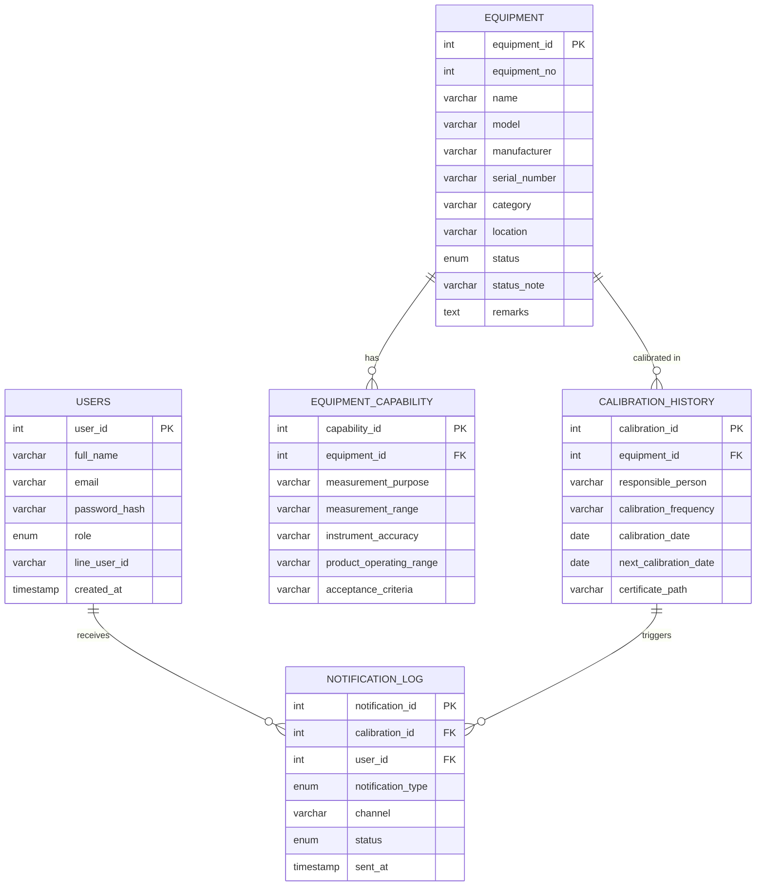

# 07 - Entity Relationship Diagram

Source: `database/schema.sql`, derived from `00 FP-ENG-05-01 Rev.02` (equipment calibration register).

## Relationship notes

- **equipment (1) → equipment_capability (N)**: one instrument can measure multiple things.
  Example from the source sheet: the *kVp Meter (Piranha 557, CB2-14060199)* has two
  capability rows — `kVp` and `Exposure Time` — sharing one equipment record. This is the
  table the **Decision Support System** queries when matching a requirement against
  equipment.
- **equipment (1) → calibration_history (N)**: calibration happens against the whole
  physical instrument, not a single capability channel — in the source sheet, every
  capability row under one instrument repeats the same "last/next calibration date".
  This table is append-only, so unlike the spreadsheet (which only shows the latest
  cycle) the database keeps full history.
- **calibration_history (1) → notification_log (N)**: each due date can trigger up to five
  reminder events (30/14/7 days before, on due date, overdue).
- **users (1) → notification_log (N)**: tracks who a LINE reminder was sent to, for audit.
- `equipment.status` is normalized into an ENUM; the original free-text value (e.g.
  `"ยกเลิกการใช้งาน 1/25"`, `"ส่งแคล 19 Jun 2026"`) is preserved in `status_note` since the
  source data encodes dates/reasons inline that don't cleanly fit an enum.
- `equipment.manufacturer` and `equipment.category` are reserved columns — the source
  sheet doesn't currently track manufacturer, and category is inferred from `name`
  until a dedicated field is populated.
